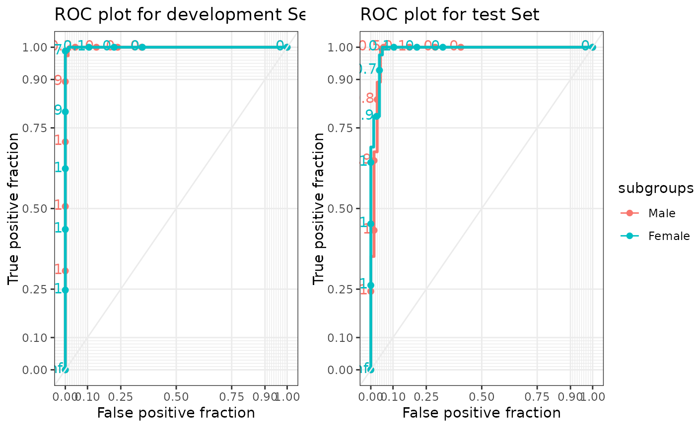

# classification model interpretation using explainer package

This is an [R Markdown](http://rmarkdown.rstudio.com) Notebook. When you
execute code within the notebook, the results appear beneath the code.

Try executing this chunk by clicking the *Run* button within the chunk
or by placing your cursor inside it and pressing *Ctrl+Shift+Enter*.

This is an example on how to use the package “explainer” developed by
Ramtin Zargari Marandi (email:<ramtin.zargari.marandi@regionh.dk>)

## Loading a dataset and training a machine learning model

This first code chunk loads a dataset and creates a binary
classification task and train a “random forest” model using mlr3
package.

``` r

Sys.setenv(LANG = "en") # change R language to English!
RNGkind("L'Ecuyer-CMRG") # change to L'Ecuyer-CMRG in case it uses default "Mersenne-Twister"

library("explainer")
# set seed for reproducibility
seed <- 246
set.seed(seed)

# load the BreastCancer data from the mlbench package
data("BreastCancer", package = "mlbench")

# keep the target column as "Class"
target_col <- "Class"

# change the positive class to "malignant"
positive_class <- "malignant"
    
# keep only the predictor variables and outcome
mydata <- BreastCancer[, -1] # 1 is ID

# remove rows with missing values
mydata <- na.omit(mydata)

# create a vector of sex categories
sex <- sample(c("Male", "Female"), size = nrow(mydata), replace = TRUE)

# create a vector of sex categories
mydata$age <- as.numeric(sample(seq(18,60), size = nrow(mydata), replace = TRUE))

# add a sex column to the mydata data frame (for fairness analysis)
mydata$sex <- factor(sex, levels = c("Male", "Female"), labels = c(1, 0))


# create a classification task
maintask <- mlr3::TaskClassif$new(id = "my_classification_task",
                                  backend = mydata,
                                  target = target_col,
                                  positive = positive_class)

# create a train-test split
set.seed(seed)
splits <- mlr3::partition(maintask)

# add a learner (machine learning model base)
# library("mlr3learners")
# library("mlr3extralearners")

# mlr_learners$get("classif.randomForest")
# here we use random forest for example (you can use any other available model)
# mylrn <- mlr3::lrn("classif.randomForest", predict_type = "prob")
library("mlr3learners")
```

    ## Loading required package: mlr3

``` r

mylrn <- mlr3::lrn("classif.ranger", predict_type = "prob")

# train the model
mylrn$train(maintask, splits$train)

# make predictions on new data
mylrn$predict(maintask, splits$test)
```

    ## 
    ## -- <PredictionClassif> for 225 observations: -----------------------------------
    ##  row_ids     truth  response prob.malignant prob.benign
    ##        2    benign malignant     0.86798175  0.13201825
    ##        5    benign    benign     0.00922619  0.99077381
    ##        7    benign    benign     0.35852381  0.64147619
    ##      ---       ---       ---            ---         ---
    ##      671    benign    benign     0.00000000  1.00000000
    ##      675    benign    benign     0.00230000  0.99770000
    ##      681 malignant malignant     0.91511905  0.08488095

### SHAP analysis to extract feature (variable) impacts on predictions

The following code chunk uses eSHAP_plot function to estimate SHAP
values for the test set and create an interactive SHAP plot. This is an
enhanced SHAP plot that means it provides additional information such as
whether the predictions were correct (TP or TN). The color mapping
provides enhanced visual inspection of the SHAP plot.

``` r

library("magrittr")
library("plotly")
```

    ## Loading required package: ggplot2

    ## 
    ## Attaching package: 'plotly'

    ## The following object is masked from 'package:ggplot2':
    ## 
    ##     last_plot

    ## The following object is masked from 'package:stats':
    ## 
    ##     filter

    ## The following object is masked from 'package:graphics':
    ## 
    ##     layout

``` r

# enhanced SHAP plot
SHAP_output <- eSHAP_plot(task = maintask,
           trained_model = mylrn,
           splits = splits,
           sample.size = 30,
           seed = seed,
           subset = .8)

# display the SHAP plot
myplot <- SHAP_output[[1]]
myplot
```

The following plot displays SHAP values associate with the predicted
probabilities.

``` r

SHAP_output[[5]]
```

    ## `geom_smooth()` using formula = 'y ~ x'


### Visualize model performance by confusion matrix

The following code chunk uses eCM_plot function to visualize the
confusion matrix to evaluate model performance for the train and test
sets. More information can be found here:
<https://en.wikipedia.org/wiki/Confusion_matrix>
<https://cran.r-project.org/web/packages/cvms/vignettes/Creating_a_confusion_matrix.html>

``` r

# enhanced confusion matrix
confusionmatrix_plot <- eCM_plot(task = maintask,
         trained_model = mylrn,
         splits = splits)
```

    ## Warning in check_gg_image_packages(add_arrows = add_arrows, add_zero_shading =
    ## add_zero_shading): 'ggimage' is missing. Will not plot arrows and zero-shading.

    ## Warning in check_gg_image_packages(add_arrows = add_arrows, add_zero_shading =
    ## add_zero_shading): 'rsvg' is missing. Will not plot arrows and zero-shading.

    ## Warning in cvms::plot_confusion_matrix(cfm, target_col = "Truth",
    ## prediction_col = "Prediction", : 'ggnewscale' is missing. Will not use palette
    ## for sum tiles.

    ## Warning in check_gg_image_packages(add_arrows = add_arrows, add_zero_shading =
    ## add_zero_shading): 'ggimage' is missing. Will not plot arrows and zero-shading.

    ## Warning in check_gg_image_packages(add_arrows = add_arrows, add_zero_shading =
    ## add_zero_shading): 'rsvg' is missing. Will not plot arrows and zero-shading.

    ## Warning in cvms::plot_confusion_matrix(cfm, target_col = "Truth",
    ## prediction_col = "Prediction", : 'ggnewscale' is missing. Will not use palette
    ## for sum tiles.

``` r

print(confusionmatrix_plot)
```

    ## $train_set


    ## 
    ## $test_set


### Decision curve analysis

The provided code chunk employs the eDecisionCurve function to conduct
“decision curve analysis” on the test set within the model. For an
in-depth understanding of this methodology, interested readers are
encouraged to explore the following authoritative references:

Decision Curve Analysis:
<https://en.wikipedia.org/wiki/Decision_curve_analysis> “Decision curve
analysis: a novel method for evaluating prediction models” by Andrew J.
Vickers and Elia B. Elkin. Link:
<https://www.ncbi.nlm.nih.gov/pmc/articles/PMC2577036/> These references
offer comprehensive insights into the principles and applications of
decision curve analysis, providing a solid foundation for further
exploration and understanding of the methodology employed in the
presented code.

``` r

# enhanced decision curve plot
eDecisionCurve(task = maintask,
         trained_model = mylrn,
         splits = splits,
         seed = seed)
```

### Model evaluation (multi-metrics and visual inspection of ROC curves)

By running the next code chunk, you will get the following model
evaluation metrics and visualizations:

**AUC (Area Under the Curve):** AUC quantifies the binary classification
model’s performance by assessing the area under the ROC curve, which
plots sensitivity against 1-specificity across various threshold values.
A value of 0.5 suggests random chance performance, while 1 signifies
perfect classification.

**BACC (Balanced Accuracy):** BACC addresses class imbalance by
averaging sensitivity and specificity. Ranging from 0 to 1, a score of 0
indicates chance performance, and 1 signifies perfect classification.

**MCC (Matthews Correlation Coefficient):** MCC evaluates binary
classification model quality, considering true positives, true
negatives, false positives, and false negatives. Ranging from -1 to 1,
-1 represents complete disagreement, 0 implies chance performance, and 1
indicates perfect classification.

**BBRIER (Brier Score):** BBRIER gauges the accuracy of probabilistic
predictions by measuring the mean squared difference between predicted
probabilities and true binary outcomes. Values range from 0 to 1, with 0
indicating perfect calibration and 1 indicating poor calibration.

**PPV (Positive Predictive Value):** PPV, or precision, measures the
proportion of true positive predictions out of all positive predictions
made by the model.

**NPV (Negative Predictive Value):** NPV quantifies the proportion of
true negative predictions out of all negative predictions made by the
model.

**Specificity:** Specificity calculates the proportion of true negative
predictions out of all actual negative cases in a binary classification
problem.

**Sensitivity:** Sensitivity, also known as recall or true positive
rate, measures the proportion of true positive predictions out of all
actual positive cases in a binary classification problem.

**PRAUC (Precision-Recall Area Under the Curve):** PRAUC assesses binary
classification model performance based on precision and recall,
quantifying the area under the precision-recall curve. A PRAUC value of
1 indicates perfect classification performance.

Additionally, the analysis involves the visualization of ROC and
Precision-Recall curves for both development and test sets.

``` r

eROC_plot(task = maintask,
         trained_model = mylrn,
         splits = splits)
```

    ## [[1]]


    ## 
    ## [[2]]
    ##             pred_results$score(measures = mlr3::msrs(meas))
    ## auc                                                    1.00
    ## bacc                                                   0.99
    ## mcc                                                    0.98
    ## bbrier                                                 0.01
    ## ppv                                                    0.98
    ## npv                                                    1.00
    ## specificity                                            0.99
    ## sensitivity                                            0.99
    ## prauc                                                  1.00
    ## 
    ## [[3]]
    ##             pred_results_test$score(measures = mlr3::msrs(meas))
    ## auc                                                         0.99
    ## bacc                                                        0.97
    ## mcc                                                         0.92
    ## bbrier                                                      0.04
    ## ppv                                                         0.93
    ## npv                                                         0.99
    ## specificity                                                 0.96
    ## sensitivity                                                 0.97
    ## prauc                                                       0.97

### ROC curves with annotated thresholds

By running the next code chunk, you will get ROC and Precision Recall
curves for the development and test sets this time with probability
threshold information.

``` r

ePerformance(task = maintask,
         trained_model = mylrn,
         splits = splits)
```

    ## Warning: Using `size` aesthetic for lines was deprecated in ggplot2 3.4.0.
    ## i Please use `linewidth` instead.
    ## i The deprecated feature was likely used in the explainer package.
    ##   Please report the issue at <https://github.com/PERSIMUNE/explainer/issues>.
    ## This warning is displayed once per session.
    ## Call `lifecycle::last_lifecycle_warnings()` to see where this warning was
    ## generated.

    ## [[1]]


    ## 
    ## [[2]]
    ## 
    ## [[3]]

### loading SHAP results for downstream analysis

Now we can get the outputs from eSHAP_plot function to apply clustering
on SHAP values

``` r

shap_Mean_wide <- SHAP_output[[2]]

shap_Mean_long <- SHAP_output[[3]]

shap <- SHAP_output[[4]]
```

### SHAP values in association with feature values

``` r

ShapFeaturePlot(shap_Mean_long)
```

## partial dependence of features

Partial dependence plots (PDPs): PDPs can be used to visualize the
marginal effect of a single feature on the model prediction.

``` r

ShapPartialPlot(shap_Mean_long = shap_Mean_long)
```

## extract feature values and predicted probabilities as output of the model to analyze

``` r

fval_predprob <- reshape2::dcast(shap, sample_num + pred_prob + predcorrectness ~ feature, value.var = "feature.value")
```

## Run a Shiny app to visualize 2-way partial dependence plots

``` r

library(shiny)
library(ggplot2)
# assuming your data.table is named `fval_predprob`
ui <- fluidPage(
  titlePanel("Feature Plot"),
  sidebarLayout(
    sidebarPanel(
      selectInput("x_feature", "X-axis Feature:",
                  choices = names(fval_predprob)),
      selectInput("y_feature", "Y-axis Feature:",
                  choices = names(fval_predprob)),
      width = 2,
      actionButton("stop_button", "Stop")
    ),
    mainPanel(
      plotOutput("feature_plot")
    )
  )
)

server <- function(input, output) {
  
  # create a reactive value for the app state
  app_state <- reactiveValues(running = TRUE)
  
  output$feature_plot <- renderPlot({
    ggplot(fval_predprob, aes(x = .data[[input$x_feature]], y = .data[[input$y_feature]], fill = pred_prob)) + 
      geom_tile() +
      scale_fill_gradient(low = "white", high = "steelblue", limits = c(0, 1)) +
      xlab(input$x_feature) +
      ylab(input$y_feature) +
      labs(shape = "correct prediction") +
      egg::theme_article()
  })
  
  # observe the stop button
  observeEvent(input$stop_button, {
    app_state$running <- FALSE
  })
  
  # stop the app if the running state is FALSE
  observe({
    if(!app_state$running) {
      stopApp()
    }
  })
}

shinyApp(ui = ui, server = server)
```

``` r

str(shap_Mean_long)
```

    ## tibble [1,980 x 9] (S3: tbl_df/tbl/data.frame)
    ##  $ feature           : chr [1:1980] "Bare.nuclei" "Bare.nuclei" "Bare.nuclei" "Bare.nuclei" ...
    ##  $ mean_phi          : num [1:1980] 0.0934 0.0934 0.0934 0.0934 0.0934 ...
    ##  $ Phi               : num [1:1980] -0.0859 -0.0821 -0.0317 0.0997 0.0817 ...
    ##  $ f_val             : num [1:1980] 0 0.111 0 0.444 0.556 ...
    ##  $ unscaled_f_val    : num [1:1980] 1 2 1 5 6 1 1 3 1 1 ...
    ##  $ sample_num        : int [1:1980] 1 2 3 4 5 6 7 8 9 10 ...
    ##  $ correct_prediction: Factor w/ 2 levels "Incorrect","Correct": 2 2 2 1 2 2 2 2 2 2 ...
    ##  $ pred_prob         : num [1:1980] 0.00255 0.00182 0 0.92977 0.9283 ...
    ##  $ pred_class        : Factor w/ 2 levels "malignant","benign": 2 2 2 1 1 2 2 1 2 2 ...

``` r

# This is the data table that includes SHAP values in wide format. Each row contains sample_num as sample ID and the SHAP values for each feature.
shap_Mean_wide
```

    ## Key: <sample_num>
    ##      sample_num Bare.nuclei  Bl.cromatin  Cell.shape   Cell.size Cl.thickness
    ##           <int>       <num>        <num>       <num>       <num>        <num>
    ##   1:          1 -0.08589487 -0.069985767 -0.04592299 -0.05557913 -0.016991720
    ##   2:          2 -0.08207815 -0.043686534 -0.06930323 -0.07851767 -0.040950132
    ##   3:          3 -0.03167399 -0.041501508 -0.05516873 -0.07578722 -0.026012011
    ##   4:          4  0.09965638  0.100056508  0.16292108  0.13855823 -0.003343413
    ##   5:          5  0.08170963  0.061670635  0.09991013  0.11153302 -0.024341667
    ##  ---                                                                         
    ## 176:        176 -0.10101344 -0.022493651 -0.09723053 -0.11001489 -0.036337381
    ## 177:        177 -0.07544257 -0.050335159 -0.07331122 -0.07960852 -0.052942063
    ## 178:        178 -0.07287780 -0.023547804 -0.08396833 -0.07580437 -0.065089868
    ## 179:        179 -0.12122407  0.054544259 -0.06030249 -0.03421050 -0.088212037
    ## 180:        180  0.17650148  0.008577434  0.08656048  0.09603124  0.118961111
    ##      Epith.c.size Marg.adhesion       Mitoses Normal.nucleoli           age
    ##             <num>         <num>         <num>           <num>         <num>
    ##   1: -0.027082751   0.002213201 -0.0022784127    -0.028862540 -0.0037774339
    ##   2: -0.010480000  -0.018519815 -0.0023586243    -0.016425476 -0.0006488360
    ##   3: -0.024506111  -0.020070503 -0.0010957672    -0.015432884 -0.0008956349
    ##   4:  0.076623836   0.041688201 -0.0006521693     0.017386984  0.0067640741
    ##   5:  0.038122116   0.030285079  0.0018288624     0.029264021 -0.0230379101
    ##  ---                                                                       
    ## 176: -0.029844048  -0.031585979  0.0005687831    -0.027441481 -0.0015749206
    ## 177: -0.024546667  -0.022700053 -0.0008221164    -0.020056270 -0.0021401058
    ## 178: -0.020292487  -0.024337857 -0.0018688889    -0.019011217  0.0006503175
    ## 179: -0.030457143  -0.004646905 -0.0040282540    -0.008570794  0.0014429101
    ## 180: -0.006486825   0.047554444  0.0024593386     0.034816376 -0.0157181481
    ##                sex
    ##              <num>
    ##   1:  0.0003026190
    ##   2: -0.0004190476
    ##   3:  0.0015755556
    ##   4:  0.0008892857
    ##   5:  0.0014779101
    ##  ---              
    ## 176:  0.0011694974
    ## 177: -0.0014722487
    ## 178:  0.0008101587
    ## 179: -0.0010852910
    ## 180: -0.0008616667

``` r

# This is the data table of SHAP values in long format and includes feature name, mean_phi_test: mean shap value for the feature across samples, scaled feature values, shap values for each feature, sample ID, and whether the prediction was correct (i.e. predicted class = actual class)
shap_Mean_long
```

    ## # A tibble: 1,980 x 9
    ##    feature  mean_phi      Phi f_val unscaled_f_val sample_num correct_prediction
    ##    <chr>       <dbl>    <dbl> <dbl>          <dbl>      <int> <fct>             
    ##  1 Bare.nu~   0.0934 -0.0859  0                  1          1 Correct           
    ##  2 Bare.nu~   0.0934 -0.0821  0.111              2          2 Correct           
    ##  3 Bare.nu~   0.0934 -0.0317  0                  1          3 Correct           
    ##  4 Bare.nu~   0.0934  0.0997  0.444              5          4 Incorrect         
    ##  5 Bare.nu~   0.0934  0.0817  0.556              6          5 Correct           
    ##  6 Bare.nu~   0.0934 -0.0518  0                  1          6 Correct           
    ##  7 Bare.nu~   0.0934 -0.113   0                  1          7 Correct           
    ##  8 Bare.nu~   0.0934 -0.00175 0.222              3          8 Correct           
    ##  9 Bare.nu~   0.0934 -0.0468  0                  1          9 Correct           
    ## 10 Bare.nu~   0.0934 -0.221   0                  1         10 Correct           
    ## # i 1,970 more rows
    ## # i 2 more variables: pred_prob <dbl>, pred_class <fct>

## Patient subgroups determined by SHAP clusters

SHAP clustering is a method to better understand why a model may perform
better for some patients than others. Here for example, you can identify
patient subgroups that have specific patterns that are different from
other subgroups and that explains why the model you developed have
perhaps better or worse performance for those patients than the average
performance for the whole dataset. You can see the difference in the
SHAP plots that if you group all together provide the overall SHAP
summary plot. Again here the edges reflect how features may interact
with each other in each individual sample (instance).

``` r

# the number of clusters can be changed
SHAP_plot_clusters <- SHAPclust(task = maintask,
         trained_model = mylrn,
         splits = splits,
         shap_Mean_wide = shap_Mean_wide,
         shap_Mean_long = shap_Mean_long,
         num_of_clusters = 3,
         seed = seed,
         subset = .8)
```

    ## Key: <sample_num, feature, Phi>
    ##       sample_num         feature           Phi cluster    mean_phi     f_val
    ##            <int>          <char>         <num>   <int>       <num>     <num>
    ##    1:          1     Bare.nuclei -0.0858948677       3 0.093444244 0.0000000
    ##    2:          1     Bl.cromatin -0.0699857672       3 0.044548987 0.0000000
    ##    3:          1      Cell.shape -0.0459229894       3 0.076720237 0.0000000
    ##    4:          1       Cell.size -0.0555791270       3 0.091198097 0.0000000
    ##    5:          1    Cl.thickness -0.0169917196       3 0.069835393 0.5000000
    ##   ---                                                                       
    ## 1976:        180   Marg.adhesion  0.0475544444       2 0.026453762 1.0000000
    ## 1977:        180         Mitoses  0.0024593386       2 0.002165296 0.1250000
    ## 1978:        180 Normal.nucleoli  0.0348163757       2 0.021391343 0.7777778
    ## 1979:        180             age -0.0157181481       2 0.003230698 0.0000000
    ## 1980:        180             sex -0.0008616667       2 0.001183048 0.0000000
    ##       unscaled_f_val correct_prediction   pred_prob pred_class
    ##                <num>             <fctr>       <num>     <fctr>
    ##    1:              1            Correct 0.002554762     benign
    ##    2:              1            Correct 0.002554762     benign
    ##    3:              1            Correct 0.002554762     benign
    ##    4:              1            Correct 0.002554762     benign
    ##    5:              5            Correct 0.002554762     benign
    ##   ---                                                         
    ## 1976:             10            Correct 0.926616667  malignant
    ## 1977:              2            Correct 0.926616667  malignant
    ## 1978:              8            Correct 0.926616667  malignant
    ## 1979:             18            Correct 0.926616667  malignant
    ## 1980:              1            Correct 0.926616667  malignant

    ## Warning in geom_jitter(aes(shape = correct_prediction, text = paste("Feature:
    ## ", : Ignoring unknown aesthetics: text

    ## Warning in ggplot2::guide_legend(color = "black"): Arguments in `...` must be used.
    ## x Problematic argument:
    ## * color = "black"
    ## i Did you misspell an argument name?

    ## Warning in check_gg_image_packages(add_arrows = add_arrows, add_zero_shading =
    ## add_zero_shading): 'ggimage' is missing. Will not plot arrows and zero-shading.

    ## Warning in check_gg_image_packages(add_arrows = add_arrows, add_zero_shading =
    ## add_zero_shading): 'rsvg' is missing. Will not plot arrows and zero-shading.

    ## Warning in check_gg_image_packages(add_arrows = add_arrows, add_zero_shading =
    ## add_zero_shading): 'ggimage' is missing. Will not plot arrows and zero-shading.

    ## Warning in check_gg_image_packages(add_arrows = add_arrows, add_zero_shading =
    ## add_zero_shading): 'rsvg' is missing. Will not plot arrows and zero-shading.

    ## Warning in check_gg_image_packages(add_arrows = add_arrows, add_zero_shading =
    ## add_zero_shading): 'ggimage' is missing. Will not plot arrows and zero-shading.

    ## Warning in check_gg_image_packages(add_arrows = add_arrows, add_zero_shading =
    ## add_zero_shading): 'rsvg' is missing. Will not plot arrows and zero-shading.

``` r

# note that the subset must be the same value as the SHAP analysis done earlier

# display the SHAP cluster plots
SHAP_plot_clusters[[1]]
```

``` r

# display the confusion matrices corresponding to the SHAP clusters (patient subsets determined by SHAP clusters)
SHAP_plot_clusters[[2]]
```


## Model fairness (sensitivity analysis)

Sometimes we would like to investigate whether our model performs fairly
well for different subgroups based on categories of variables such as
sex.

``` r

# you should decide what variables to use to be tested
# here we chose sex from the variables existing in the dataset

Fairness_results <- eFairness(task = maintask,
         trained_model = mylrn,
         splits = splits,
         target_variable = "sex",
         var_levels = c("Male", "Female"))
```

    ## Warning in verify_d(data$d): D not labeled 0/1, assuming benign = 0 and
    ## malignant = 1!
    ## Warning in verify_d(data$d): D not labeled 0/1, assuming benign = 0 and
    ## malignant = 1!
    ## Warning in verify_d(data$d): D not labeled 0/1, assuming benign = 0 and
    ## malignant = 1!

``` r

# ROC curves for the subgroups for the development (left) and test (right) sets
Fairness_results[[1]]
```



``` r

# performance in the subgroups for the development set
Fairness_results[[2]]
```

    ##             Male Female
    ## auc         1.00   1.00
    ## bacc        0.99   0.99
    ## mcc         0.97   0.98
    ## bbrier      0.01   0.01
    ## ppv         0.96   0.99
    ## npv         1.00   0.99
    ## specificity 0.98   0.99
    ## sensitivity 1.00   0.99
    ## prauc       1.00   1.00

``` r

# performance in the subgroups for the test set
Fairness_results[[3]]
```

    ##             Male Female
    ## auc         0.98   0.99
    ## bacc        0.98   0.96
    ## mcc         0.94   0.91
    ## bbrier      0.04   0.03
    ## ppv         0.92   0.93
    ## npv         1.00   0.97
    ## specificity 0.96   0.96
    ## sensitivity 1.00   0.95
    ## prauc       0.96   0.98

### Model parameters

``` r

# get model parameters
model_params <- mylrn$param_set

print(data.table::as.data.table(model_params))
```

    ##                               id    class lower upper
    ##                           <char>   <char> <num> <num>
    ##  1:       always.split.variables ParamUty    NA    NA
    ##  2:                class.weights ParamUty    NA    NA
    ##  3:                      holdout ParamLgl    NA    NA
    ##  4:                   importance ParamFct    NA    NA
    ##  5:                   keep.inbag ParamLgl    NA    NA
    ##  6:                    max.depth ParamInt     1   Inf
    ##  7:                   min.bucket ParamUty    NA    NA
    ##  8:                min.node.size ParamUty    NA    NA
    ##  9:                         mtry ParamInt     1   Inf
    ## 10:                   mtry.ratio ParamDbl     0     1
    ## 11:                    na.action ParamFct    NA    NA
    ## 12:            num.random.splits ParamInt     1   Inf
    ## 13:                   node.stats ParamLgl    NA    NA
    ## 14:                  num.threads ParamInt     1   Inf
    ## 15:                    num.trees ParamInt     1   Inf
    ## 16:                    oob.error ParamLgl    NA    NA
    ## 17:        regularization.factor ParamUty    NA    NA
    ## 18:      regularization.usedepth ParamLgl    NA    NA
    ## 19:                      replace ParamLgl    NA    NA
    ## 20:    respect.unordered.factors ParamFct    NA    NA
    ## 21:              sample.fraction ParamDbl     0     1
    ## 22:                  save.memory ParamLgl    NA    NA
    ## 23: scale.permutation.importance ParamLgl    NA    NA
    ## 24:             local.importance ParamLgl    NA    NA
    ## 25:                         seed ParamInt  -Inf   Inf
    ## 26:         split.select.weights ParamUty    NA    NA
    ## 27:                    splitrule ParamFct    NA    NA
    ## 28:                      verbose ParamLgl    NA    NA
    ## 29:                 write.forest ParamLgl    NA    NA
    ##                               id    class lower upper
    ##                           <char>   <char> <num> <num>
    ##                                           levels nlevels is_bounded
    ##                                           <list>   <num>     <lgcl>
    ##  1:                                       [NULL]     Inf      FALSE
    ##  2:                                       [NULL]     Inf      FALSE
    ##  3:                                   TRUE,FALSE       2       TRUE
    ##  4: none,impurity,impurity_corrected,permutation       4       TRUE
    ##  5:                                   TRUE,FALSE       2       TRUE
    ##  6:                                       [NULL]     Inf      FALSE
    ##  7:                                       [NULL]     Inf      FALSE
    ##  8:                                       [NULL]     Inf      FALSE
    ##  9:                                       [NULL]     Inf      FALSE
    ## 10:                                       [NULL]     Inf       TRUE
    ## 11:                     na.learn,na.omit,na.fail       3       TRUE
    ## 12:                                       [NULL]     Inf      FALSE
    ## 13:                                   TRUE,FALSE       2       TRUE
    ## 14:                                       [NULL]     Inf      FALSE
    ## 15:                                       [NULL]     Inf      FALSE
    ## 16:                                   TRUE,FALSE       2       TRUE
    ## 17:                                       [NULL]     Inf      FALSE
    ## 18:                                   TRUE,FALSE       2       TRUE
    ## 19:                                   TRUE,FALSE       2       TRUE
    ## 20:                       ignore,order,partition       3       TRUE
    ## 21:                                       [NULL]     Inf       TRUE
    ## 22:                                   TRUE,FALSE       2       TRUE
    ## 23:                                   TRUE,FALSE       2       TRUE
    ## 24:                                   TRUE,FALSE       2       TRUE
    ## 25:                                       [NULL]     Inf      FALSE
    ## 26:                                       [NULL]     Inf      FALSE
    ## 27:                    gini,extratrees,hellinger       3       TRUE
    ## 28:                                   TRUE,FALSE       2       TRUE
    ## 29:                                   TRUE,FALSE       2       TRUE
    ##                                           levels nlevels is_bounded
    ##                                           <list>   <num>     <lgcl>
    ##     special_vals        default storage_type                   tags
    ##           <list>         <list>       <char>                 <list>
    ##  1:    <list[0]> <NoDefault[0]>         list                  train
    ##  2:    <list[0]>         [NULL]         list                  train
    ##  3:    <list[0]>          FALSE      logical                  train
    ##  4:    <list[0]> <NoDefault[0]>    character                  train
    ##  5:    <list[0]>          FALSE      logical                  train
    ##  6:    <list[1]>         [NULL]      integer                  train
    ##  7:    <list[0]>              1         list                  train
    ##  8:    <list[1]>         [NULL]         list                  train
    ##  9:    <list[1]> <NoDefault[0]>      integer                  train
    ## 10:    <list[0]> <NoDefault[0]>      numeric                  train
    ## 11:    <list[0]>       na.learn    character                  train
    ## 12:    <list[0]>              1      integer                  train
    ## 13:    <list[0]>          FALSE      logical                  train
    ## 14:    <list[0]>              1      integer  train,predict,threads
    ## 15:    <list[0]>            500      integer train,predict,hotstart
    ## 16:    <list[0]>           TRUE      logical                  train
    ## 17:    <list[0]>              1         list                  train
    ## 18:    <list[0]>          FALSE      logical                  train
    ## 19:    <list[0]>           TRUE      logical                  train
    ## 20:    <list[0]> <NoDefault[0]>    character                  train
    ## 21:    <list[0]> <NoDefault[0]>      numeric                  train
    ## 22:    <list[0]>          FALSE      logical                  train
    ## 23:    <list[0]>          FALSE      logical                  train
    ## 24:    <list[0]>          FALSE      logical                  train
    ## 25:    <list[1]>         [NULL]      integer          train,predict
    ## 26:    <list[0]>         [NULL]         list                  train
    ## 27:    <list[0]>           gini    character                  train
    ## 28:    <list[0]>           TRUE      logical          train,predict
    ## 29:    <list[0]>           TRUE      logical                  train
    ##     special_vals        default storage_type                   tags
    ##           <list>         <list>       <char>                 <list>
