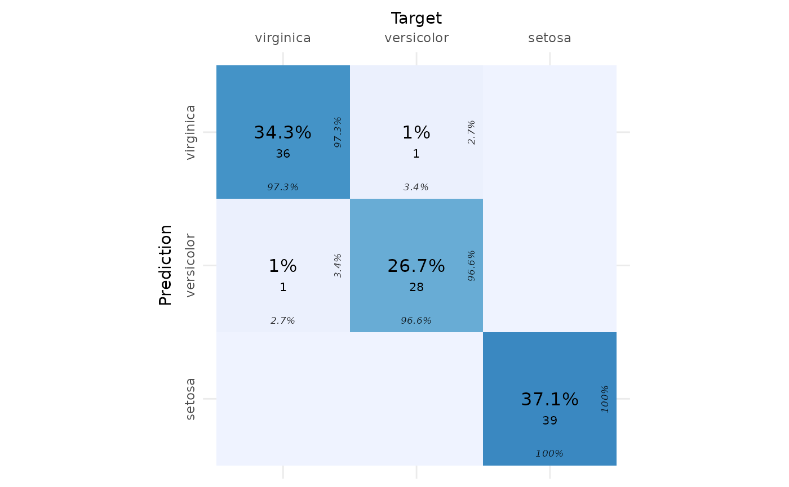
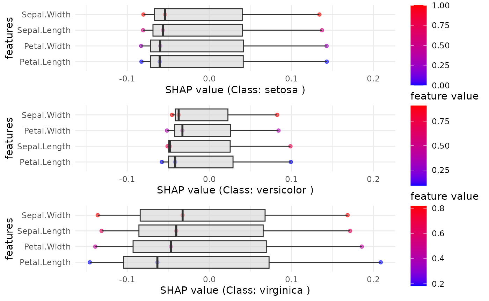
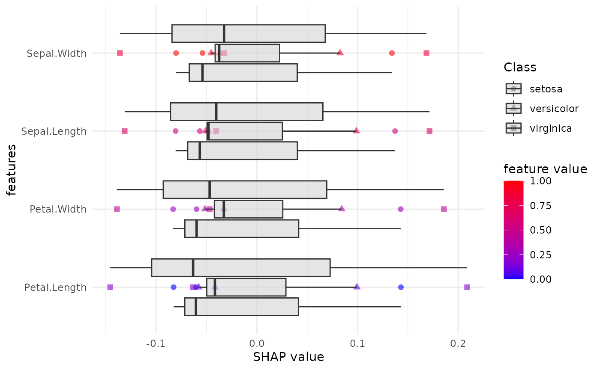

# SHAP analysis in multi-class classification tasks

## Load Required Libraries

We will begin by loading the necessary packages.

``` r

library(explainer)
library(mlbench)
library(mlr3learners)
```

    ## Loading required package: mlr3

``` r

library(ranger)
library(iml)
library(dplyr)
```

    ## 
    ## Attaching package: 'dplyr'

    ## The following objects are masked from 'package:stats':
    ## 
    ##     filter, lag

    ## The following objects are masked from 'package:base':
    ## 
    ##     intersect, setdiff, setequal, union

``` r

library(ggplot2)
library(plotly)
```

    ## 
    ## Attaching package: 'plotly'

    ## The following object is masked from 'package:ggplot2':
    ## 
    ##     last_plot

    ## The following object is masked from 'package:stats':
    ## 
    ##     filter

    ## The following object is masked from 'package:graphics':
    ## 
    ##     layout

``` r

library(cvms)
library(ggplot2)
library(gridExtra)
```

    ## 
    ## Attaching package: 'gridExtra'

    ## The following object is masked from 'package:dplyr':
    ## 
    ##     combine

## Set Seed for Reproducibility

``` r

seed <- 246
set.seed(seed)
```

## Load and Prepare the Data

We will use the Iris dataset for this example and define the target
column (`Species`).

``` r

# Load the Iris dataset
data("iris")
target_col <- "Species"

# Extract relevant columns from the dataset
mydata <- iris
```

## Create the Classification Task

We create a classification task using the `mlr3` package.

``` r

maintask <- mlr3::TaskClassif$new(
  id = "my_classification_task",
  backend = mydata,
  target = target_col
)
```

## Split the Dataset

We will split the data into training and test sets.

``` r

splits <- mlr3::partition(maintask, ratio = 0.3)
```

## Train the Model

Using the ranger algorithm, we will train a classification model.

``` r

mylrn <- mlr3::lrn("classif.ranger", predict_type = "prob")
mylrn$train(maintask, splits$train)
```

## Make Predictions

Once the model is trained, we make predictions on the test set.

``` r

# Make predictions on the test set
predictions <- mylrn$predict(maintask, splits$test)

# Convert predictions to a data frame
predicted_classes <- predictions$response
true_classes <- mydata[splits$test, target_col]
```

## Confusion Matrix

We create and visualize a confusion matrix using the `cvms` package.

``` r

# Create a confusion matrix
conf_matrix <- table(True = true_classes, Predicted = predicted_classes)

# Convert the confusion matrix to a data frame with required column names
conf_matrix_df <- as.data.frame(conf_matrix)
colnames(conf_matrix_df) <- c("Target", "Prediction", "N")

# Plot the confusion matrix
plot_confusion_matrix(conf_matrix_df)
```

    ## Warning in check_gg_image_packages(add_arrows = add_arrows, add_zero_shading =
    ## add_zero_shading): 'ggimage' is missing. Will not plot arrows and zero-shading.

    ## Warning in check_gg_image_packages(add_arrows = add_arrows, add_zero_shading =
    ## add_zero_shading): 'rsvg' is missing. Will not plot arrows and zero-shading.



## SHAP (SHapley Additive exPlanations) Analysis

We will now compute SHAP values for the dataset to understand the
feature importance for each class.

We now use the SHAP function to generate the SHAP plots for each class
and a combined plot for all classes.

``` r

SHAP_output <- eSHAP_plot_multiclass(
  task = maintask,
  trained_model = mylrn,
  splits = splits,
  sample.size = 30,
  seed = seed,
  subset = 0.8
)
```



``` r

# Display the combined SHAP plot for each class
print(SHAP_output$combined_plot)
```

    ## TableGrob (3 x 1) "arrange": 3 grobs
    ##            z     cells    name           grob
    ## setosa     1 (1-1,1-1) arrange gtable[layout]
    ## versicolor 2 (2-2,1-1) arrange gtable[layout]
    ## virginica  3 (3-3,1-1) arrange gtable[layout]

## Display the combined plot for all classes together

``` r

print(SHAP_output$combined_all_classes)
```



### Notes:

- This script loads the Iris dataset, trains a classifier using the
  `ranger` algorithm, makes predictions, creates a confusion matrix, and
  calculates SHAP values for feature importance.
- SHAP values are visualized per class and across all classes using
  `ggplot2`.
